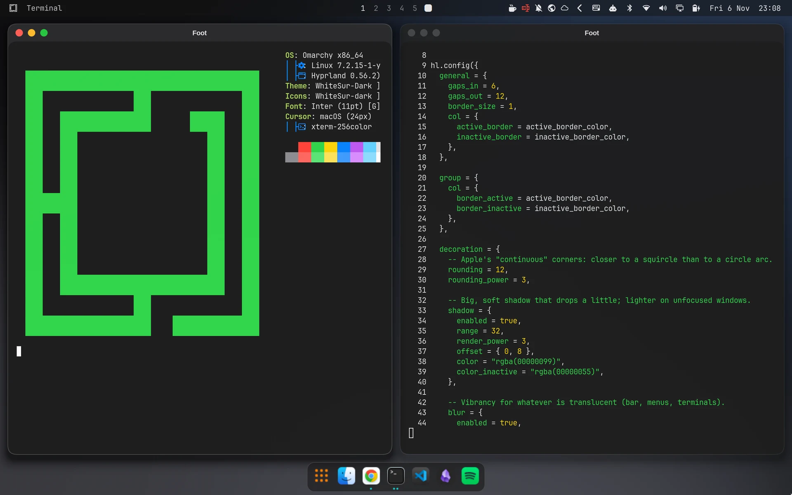
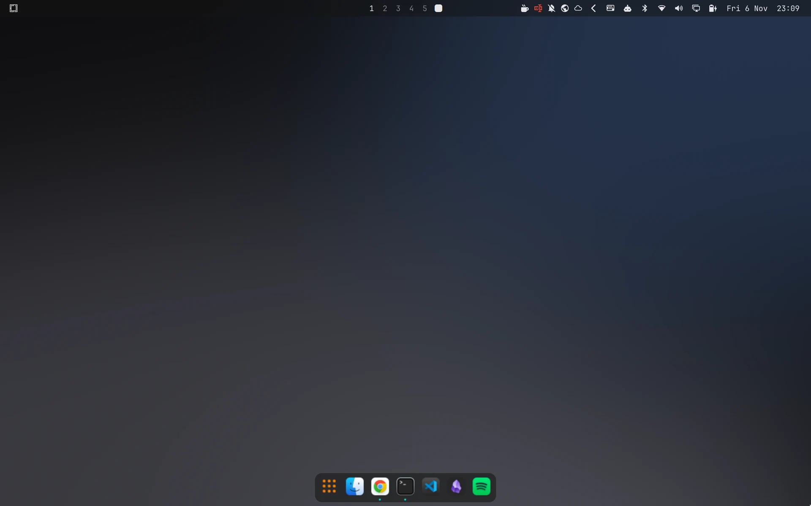
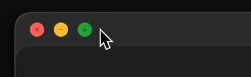
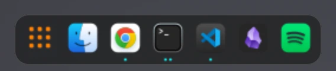

# omarchy-macos

[](https://github.com/robertgarcia/omarchy-macos/actions/workflows/ci.yml)
[](LICENSE)

[English](README.md) · **Español**

Aspecto macOS (modo oscuro) para [Omarchy](https://omarchy.org/) 4.x sobre Hyprland, aplicado por capas y siempre reversible.



| Escritorio | Botones de semáforo | Dock |
|---|---|---|
|  |  |  |

## Capas

| # | Capa | Qué cambia |
|---|------|------------|
| 0 | Copia de seguridad y rollback | Nada; guarda lo que tocan las demás |
| 1 | Tema Omarchy `macos` | Colores y dos fondos originales |
| 2 | Ventanas | Esquinas, sombras, desenfoque, animaciones |
| 3 | Barra superior | Disposición y transparencia de la barra de Omarchy |
| 4 | Fuentes, iconos, cursor y GTK | Inter, iconos y tema GTK WhiteSur, cursor macOS |
| 5 | Dock | `nwg-dock-hyprland` abajo |
| 6 | Botones de semáforo | Cerrar, minimizar y ampliar en cada ventana |

Las capas 1, 2, 4, 5 y 6 van con el tema: al cambiar a otro tema de Omarchy se apagan y al volver se encienden. La capa 3 cambia la disposición de tu barra y se queda aunque cambies de tema.

## Requisitos

- Omarchy 4.x con la configuración de Hyprland en Lua. Probado en Omarchy 4.5.0 con Hyprland 0.56.2.
- `yay` para los paquetes de AUR de la capa 4 (Omarchy ya lo trae).
- Para la capa 6, el paquete `omarchy-hyprland-titlebars`, que forma parte de la instalación base de Omarchy.

> [!IMPORTANT]
> No lo instales con `omarchy theme install`. Ese comando trata todo el repositorio como la carpeta de un tema, pero el tema está en `themes/macos/`, y el dock, los semáforos y las fuentes necesitan los pasos de abajo.

Clona el repositorio y ejecuta todos los comandos desde su raíz, porque los enlaces apuntan a `$PWD`:

```bash
git clone https://github.com/robertgarcia/omarchy-macos.git
cd omarchy-macos
```

## Antes de empezar

```bash
omarchy snapshot create     # instantánea del sistema (paquetes, /usr, /etc)
scripts/backup.sh           # copia de lo que se toca en $HOME
```

Snapper no cubre `/home` en Omarchy, así que `backup.sh` hace falta aunque tengas instantáneas.
Guarda las rutas de `scripts/managed-paths.sh`, la lista de paquetes instalados, los ajustes GTK (dconf) y el tema y la fuente actuales en `~/.local/share/omarchy-macos/backups/<fecha>/`.

## Capa 1: tema

```bash
ln -s "$PWD/themes/macos" ~/.config/omarchy/themes/macos
omarchy theme set macos
```

Colores del modo oscuro de macOS (`systemBlue` como acento) y dos fondos abstractos originales (`1-noche`, `2-grafito`). Cambia de fondo con `omarchy theme bg next`.

Omarchy aplica los temas copiándolos. Si editas algo en `themes/macos`, vuelve a ejecutar `omarchy theme set macos`.

## Capa 2: ventanas

Va dentro del tema, en `themes/macos/hyprland.lua`, así que se activa y se desactiva al cambiar de tema. No toca `~/.config/hypr`.
Esquinas de 12 px casi en forma de squircle, borde fino, sombra amplia que cae un poco, desenfoque para lo translúcido, ventanas que aparecen creciendo desde el 92 % y escritorios que se deslizan de lado, como los Spaces de macOS.

Lo que pongas en `~/.config/hypr/looknfeel.lua` o actives con un toggle de Omarchy se carga después y manda sobre esto.

## Capa 3: barra superior

```bash
omarchy bar background glassy     # translúcida con desenfoque
python3 scripts/bar-layout.py     # reordena ~/.config/omarchy/shell.json
```

Izquierda: menú de Omarchy (el equivalente al menú Apple) y el título de la ventana activa. Centro: escritorios. Derecha: todos los iconos de estado y el reloj al final (`Fri 6 Nov  19:38`).
El script conserva cualquier widget que no conozca (lo pone a la derecha) y se puede ejecutar varias veces sin cambiar el resultado.
Esta capa no forma parte del tema: si cambias de tema, la barra conserva esta disposición.

## Capa 4: fuentes, iconos, cursor y GTK

```bash
yay -S --needed inter-font whitesur-icon-theme whitesur-gtk-theme apple_cursor
ln -s "$PWD/hooks/theme-set-macos.sh" ~/.config/omarchy/hooks/theme-set.d/macos.sh
omarchy theme set macos
```

- Los iconos `WhiteSur-dark` vienen del `icons.theme` del tema.
- El hook `hooks/theme-set-macos.sh` se ejecuta cada vez que cambias de tema. Con `macos` pone el tema GTK `WhiteSur-Dark`, el cursor `macOS` y la fuente de interfaz `Inter 11`. Con cualquier otro tema quita solo lo que puso él.
- Las apps libadwaita (GTK4, como Files) ignoran el tema GTK. Por eso el hook extrae el CSS de WhiteSur en `~/.config/gtk-4.0/whitesur/` y crea un `gtk.css` marcado que lo importa. Nunca sobrescribe un `gtk.css` tuyo. Las apps abiertas solo lo ven al reiniciarlas.
- La fuente de la barra y de las terminales sigue siendo la monoespaciada de Omarchy. Es una sola fuente para las dos cosas, y si fuera proporcional las terminales no alinearían bien.

## Capa 5: dock

```bash
sudo pacman -S --needed nwg-dock-hyprland
ln -s "$PWD/dock" ~/.config/nwg-dock-hyprland
omarchy theme set macos
```

- **Posición:** siempre visible abajo, como en macOS por defecto. Las ventanas maximizadas se detienen encima del dock.
- **Aspecto:** translúcido con desenfoque e iconos WhiteSur. Un punto bajo cada app abierta.
- **Primer botón:** abre la cuadrícula de apps de Omarchy (el Launchpad).
- **Apps fijadas:** salen de `dock/pinned` la primera vez. Edita ese archivo antes del primer arranque para que coincida con tus apps; después se fijan o quitan con clic derecho.
- **Arranque:** solo se abre al iniciar sesión si el tema es `macos`, y el hook lo abre o lo cierra al cambiar de tema.
- **Monitores:** aparece en la pantalla externa si hay una conectada, y si no, en la del portátil. Si conectas la externa con la sesión ya iniciada, el dock se queda donde estaba hasta que se reinicie.

## Capa 6: botones de semáforo

No hay que instalar nada. Va dentro del tema, así que se activa con `omarchy theme set macos`.

- **Plugin:** es el `hyprbars` que Omarchy ya trae para sus escritorios flotantes (paquete `omarchy-hyprland-titlebars`). Omarchy lo recompila con cada versión de Hyprland, así que no hay que recompilarlo tras actualizar.
- **Activación:** el tema lo carga en todas las ventanas, también en las de mosaico. Al cambiar de tema, Hyprland lo descarga.
- **Barra:** 28 px, con el título centrado en Inter.
- **Botones:** cerrar, minimizar y ampliar, a la izquierda. Los símbolos solo aparecen al pasar el ratón por encima. Las ventanas sin foco muestran los botones en gris.
- **Doble clic en la barra:** amplía la ventana, igual que el botón verde.
- **Minimizar:** manda la ventana a un escritorio oculto. Al pulsar su icono en el dock vuelve al escritorio que tengas delante.
- **Botones GTK:** el hook oculta los botones propios de las apps GTK (Files y otras) para que no haya dos juegos. Al salir del tema los devuelve.

## Deshacer

```bash
scripts/rollback.sh [carpeta-de-copia]   # por defecto, la copia más reciente
```

Funciona desde una consola de texto (Ctrl+Alt+F3) si Hyprland no arranca. Esto es lo que hace:

1. Devuelve las rutas gestionadas a su estado anterior. Antes guarda lo que hay en ese momento en `<copia>/replaced-<fecha>/`, así que no se pierde nada.
2. Desinstala los paquetes de `packages.txt` que no estaban instalados antes.
3. Restaura los ajustes GTK, incluidos los botones de las ventanas.
4. Vuelve a aplicar el tema y la fuente que había. Con eso desaparecen los botones de semáforo.

Ojo: también devuelve a su estado anterior **cualquier** cambio que hayas hecho en esas rutas después de la copia, aunque no tenga nada que ver con este proyecto (por ejemplo, un atajo nuevo en `~/.config/hypr`). Lo encontrarás en `replaced-<fecha>/`.

Si algo va peor que eso, arranca una instantánea anterior desde el menú de Limine.

## Pruebas

```bash
tests/roundtrip.sh   # backup -> cambios -> rollback sobre un $HOME falso
```

La CI también pasa `shellcheck`, una comprobación de sintaxis de Lua y otra de Python en cada pull request.

## Contribuir

Los issues y los pull requests son bienvenidos, en español o en inglés. Empieza por [CONTRIBUTING.md](CONTRIBUTING.md).

## Licencia

[MIT](LICENSE). Los fondos se hicieron para este proyecto y tienen la misma licencia. WhiteSur, Inter, el cursor macOS y nwg-dock-hyprland se instalan desde sus propios paquetes, con sus propias licencias.

Este proyecto no está afiliado a Apple ni cuenta con su respaldo. macOS es una marca registrada de Apple Inc.
