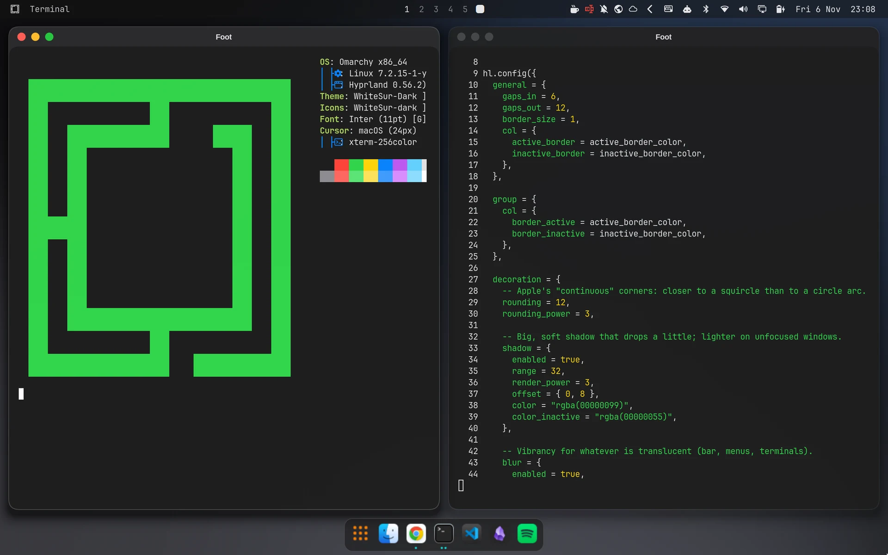
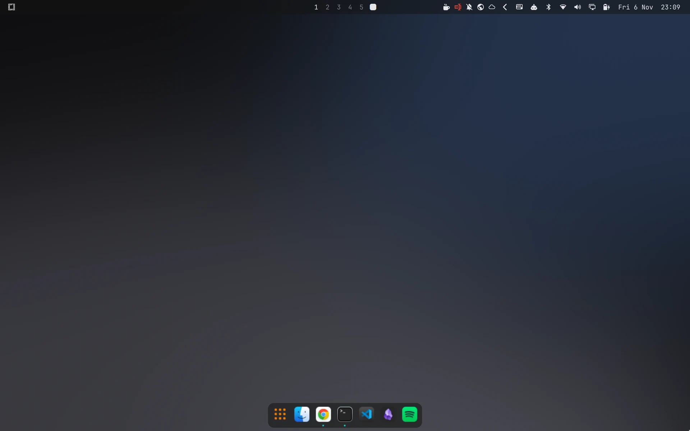
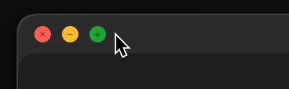
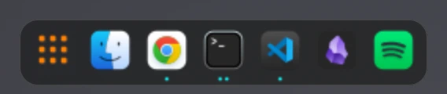

# omarchy-macos

[](https://github.com/robertgarcia/omarchy-macos/actions/workflows/ci.yml)
[](LICENSE)

**English** · [Español](README.es.md)

A dark macOS look for [Omarchy](https://omarchy.org/) 4.x on Hyprland. It is applied in layers, and every layer can be undone.



| Desktop | Traffic lights | Dock |
|---|---|---|
|  |  |  |

## Layers

| # | Layer | What it changes |
|---|-------|-----------------|
| 0 | Backup and rollback | Nothing; it saves what the other layers touch |
| 1 | Omarchy theme `macos` | Colors and two original wallpapers |
| 2 | Windows | Corners, shadows, blur, animations |
| 3 | Top bar | Layout and translucency of the Omarchy bar |
| 4 | Fonts, icons, cursor and GTK | Inter, WhiteSur icons and GTK theme, macOS cursor |
| 5 | Dock | `nwg-dock-hyprland` at the bottom |
| 6 | Traffic lights | Close, minimize and zoom buttons on every window |

Layers 1, 2, 4, 5 and 6 follow the theme: switching to another Omarchy theme turns them off, and switching back turns them on. Layer 3 changes your bar layout and stays when you switch themes.

## Requirements

- Omarchy 4.x with its Lua Hyprland config. Tested on Omarchy 4.5.0 with Hyprland 0.56.2.
- `yay` for the AUR packages in layer 4 (Omarchy ships it).
- For layer 6, the `omarchy-hyprland-titlebars` package, which is part of Omarchy's base install.

> [!IMPORTANT]
> Do not install this with `omarchy theme install`. That command treats the whole repository as one theme folder, but the theme lives in `themes/macos/`, and the dock, traffic lights and fonts need the steps below.

Clone the repository and run every command below from its root, because the links point at `$PWD`:

```bash
git clone https://github.com/robertgarcia/omarchy-macos.git
cd omarchy-macos
```

## Before you start

```bash
omarchy snapshot create     # system snapshot (packages, /usr, /etc)
scripts/backup.sh           # copy of what this project touches in $HOME
```

Omarchy's snapshots do not cover `/home`, so you need `backup.sh` even if you take snapshots.
It saves the paths listed in `scripts/managed-paths.sh`, the list of installed packages, the GTK settings (dconf) and your current theme and font in `~/.local/share/omarchy-macos/backups/<date>/`.

## Layer 1: theme

```bash
ln -s "$PWD/themes/macos" ~/.config/omarchy/themes/macos
omarchy theme set macos
```

macOS dark mode colors, with `systemBlue` as the accent, and two original abstract wallpapers (`1-noche`, `2-grafito`). Cycle them with `omarchy theme bg next`.

Omarchy applies a theme by copying it. After you edit anything under `themes/macos`, run `omarchy theme set macos` again.

## Layer 2: windows

It lives inside the theme, in `themes/macos/hyprland.lua`, so it does not touch `~/.config/hypr`.
It gives 12 px squircle-like corners, a hairline border and a large soft shadow that drops slightly. It also adds blur for translucent surfaces, windows that grow in from 92 %, and workspaces that slide sideways like macOS Spaces.

Anything you set in `~/.config/hypr/looknfeel.lua` or turn on with an Omarchy toggle loads later and wins.

## Layer 3: top bar

```bash
omarchy bar background glassy     # translucent, with blur
python3 scripts/bar-layout.py     # rearranges ~/.config/omarchy/shell.json
```

- **Left:** the Omarchy menu (the Apple menu equivalent) and the title of the active window.
- **Center:** workspaces.
- **Right:** every status icon, with the clock last (`Fri 6 Nov  19:38`).

The script keeps any widget it does not know, moving it to the right, and running it again does not change the result.

## Layer 4: fonts, icons, cursor and GTK

```bash
yay -S --needed inter-font whitesur-icon-theme whitesur-gtk-theme apple_cursor
ln -s "$PWD/hooks/theme-set-macos.sh" ~/.config/omarchy/hooks/theme-set.d/macos.sh
omarchy theme set macos
```

- The `WhiteSur-dark` icons come from the theme's `icons.theme`.
- The hook `hooks/theme-set-macos.sh` runs on every theme change. With `macos` it sets the `WhiteSur-Dark` GTK theme, the `macOS` cursor and the `Inter 11` UI font. With any other theme it removes only what it set.
- libadwaita (GTK4) apps such as Files ignore the GTK theme. The hook therefore unpacks WhiteSur's CSS into `~/.config/gtk-4.0/whitesur/` and writes a marked `gtk.css` that imports it.
  - It never overwrites a `gtk.css` of your own.
  - Running apps pick it up only after a restart.
- The bar and the terminals keep Omarchy's monospace font. A single font serves both, and a proportional one would misalign the terminals.

## Layer 5: dock

```bash
sudo pacman -S --needed nwg-dock-hyprland
ln -s "$PWD/dock" ~/.config/nwg-dock-hyprland
omarchy theme set macos
```

- **Position:** always visible at the bottom, like macOS by default. Maximized windows stop above it.
- **Look:** translucent with blur and WhiteSur icons. A dot marks each running app.
- **First button:** opens Omarchy's app grid, the Launchpad equivalent.
- **Pinned apps:** seeded from `dock/pinned` on first run. Edit that file before the first run to match your apps; after that, pin and unpin with a right click.
- **Startup:** the dock starts at login only while the theme is `macos`. The hook starts or stops it when you switch themes.
- **Monitors:** the dock opens on the external monitor when one is connected, otherwise on the laptop panel. A monitor plugged in later gets the dock after the dock restarts.

## Layer 6: traffic lights

Nothing to install. It lives inside the theme, so `omarchy theme set macos` turns it on.

- **Plugin:** the `hyprbars` build that Omarchy already ships for its floating workspaces (package `omarchy-hyprland-titlebars`). Omarchy rebuilds it for every Hyprland release, so there is nothing to recompile after updates.
- **Where:** on every window, tiled ones included. Hyprland unloads it when you switch themes.
- **Title bar:** 28 px, with the title centered in Inter.
- **Buttons:** close, minimize and zoom on the left. The symbols appear on hover, and unfocused windows show grey buttons.
- **Double click on the bar:** zooms the window, like the green button.
- **Minimize:** sends the window to a hidden workspace. Clicking its icon in the dock brings it back to the workspace in front of you.
- **GTK buttons:** the hook hides GTK apps' own window buttons so there are not two sets. It restores them when you leave the theme.

## Undo

```bash
scripts/rollback.sh [backup-dir]   # defaults to the most recent backup
```

It works from a text console (Ctrl+Alt+F3) if Hyprland does not start. This is what it does:

1. **Files:** it puts the managed paths back as they were. It first copies what is there into `<backup>/replaced-<date>/`, so nothing is lost.
2. **Packages:** it uninstalls the packages in `packages.txt` that were not installed before.
3. **GTK:** it restores the GTK settings, window buttons included.
4. **Theme:** it re-applies your previous theme and font, which also removes the traffic lights.

The rollback also reverts **any** change you made to those paths after the backup, even one unrelated to this project, such as a new keybinding in `~/.config/hypr`. You will find it in `replaced-<date>/`.

If things go worse than that, boot an earlier snapshot from the Limine menu.

## Tests

```bash
tests/roundtrip.sh   # backup -> changes -> rollback against a fake $HOME
```

CI also runs `shellcheck`, a Lua syntax check and a Python compile check on every pull request.

## Contributing

Issues and pull requests are welcome, in English or Spanish. Start with [CONTRIBUTING.md](CONTRIBUTING.md).

## License

[MIT](LICENSE). The wallpapers were made for this project and are under the same license. WhiteSur, Inter, the macOS cursor and nwg-dock-hyprland are installed from their own packages under their own licenses.

This project is not affiliated with or endorsed by Apple. macOS is a trademark of Apple Inc.
